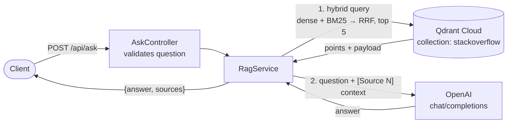

# Hybrid RAG over Stack Overflow with Spring Boot, Qdrant and OpenAI

A small Spring Boot 3.4 / Java 21 service that answers software-engineering questions from a Stack Overflow Q&A collection stored in Qdrant Cloud. Each question is answered in two steps:

1. **Hybrid retrieval in Qdrant.** One query runs a dense semantic search (Qdrant Cloud inference with `sentence-transformers/all-minilm-l6-v2`) and a BM25 full-text search side by side, then Qdrant fuses the two ranked lists with **Reciprocal Rank Fusion (RRF)** and returns the top 5 records.
2. **Grounded generation with OpenAI.** The usable records are formatted as numbered `[Source N]` excerpts and sent to the OpenAI Chat Completions API with a system prompt that tells the model to treat the excerpts as untrusted data and cite them.

The service returns the model's answer together with the IDs and questions of the records it used.

## Architecture



The detailed flow chart, including every branch and error path, and a sequence diagram are in [docs/architecture.md](docs/architecture.md).

## Project layout

| Path | Purpose |
| --- | --- |
| `HybridRagApplication` | Spring Boot entry point. |
| `api/AskController` | `POST /api/ask`. Validates the body with Bean Validation and delegates to `RagService`. |
| `service/RagService` | The whole RAG pipeline: `buildHybridSearchRequest` → `queryQdrant` → `buildContext` → `buildLlmRequest` → `callLlm`. |
| `config/HttpClientConfig` | Shared `RestClient.Builder` on the JDK `HttpClient`, with a 10 s connect timeout and a 90 s read timeout. |
| `dto/AskRequest`, `AskResponse`, `Source` | Request and response records. |
| `docs/architecture.md` | Flow chart and sequence diagram. |

## How a request is handled

1. `POST /api/ask` receives `{"question": "..."}`. The question must not be blank and must be at most 4000 characters, otherwise the response is `400 Bad Request`.
2. `RagService` builds one Qdrant query with two prefetches:
   - a dense query `{text, model}` against the collection's **unnamed** vector, limit 10, embedded server-side by Qdrant Cloud inference;
   - a BM25 query `{text}` using the `text` index, limit 10;
   - fused with `{"fusion": "rrf"}`, limit 5, `with_payload: true`.
3. The query is sent to `POST {QDRANT_URI}/collections/{collection}/points/query` with the `api-key` header.
4. If Qdrant returns no points, the service answers `"No matching Stack Overflow records were found."` with an empty source list, and OpenAI is not called.
5. Each hit's `payload.question` and `payload.accepted_answer` are read. Hits missing either one are skipped. The rest are numbered `[Source 1]`, `[Source 2]`, ... with the question cut to 1500 characters and the answer to 4000 characters, which bounds the prompt size. If no hit is usable, the service answers `"Matching records had no usable accepted answers."` and OpenAI is not called.
6. A chat-completions request is sent to `https://api.openai.com/v1/chat/completions` with the configured model, the system prompt, and a user message containing the question and the retrieved context.
7. The first choice's `message.content` is returned as `answer`. If OpenAI returns no choices or a blank answer, `RagService` throws `IllegalStateException`, which surfaces as a 500. Upstream HTTP errors and timeouts also surface as 500, since there is no custom exception mapping yet.

## Prerequisites

- Java 21 and Maven 3.9+
- A Qdrant Cloud cluster with:
  - a collection (default name `stackoverflow`) with an unnamed 384-dimension dense vector, populated by your ingestion script;
  - payload fields `question`, `accepted_answer` and `text`;
  - a BM25-scoring full-text index on the `text` payload field;
  - Cloud inference enabled with the `sentence-transformers/all-minilm-l6-v2` model.
- An OpenAI API key with access to the configured chat model.

## Configuration

Settings live in `src/main/resources/application.yml`.

| Property | Environment variable | Default | Notes |
| --- | --- | --- | --- |
| `qdrant.uri` | `QDRANT_URI` | none, required | e.g. `https://YOUR-CLUSTER.cloud.qdrant.io` |
| `qdrant.api-key` | `QDRANT_API_KEY` | none, required | Sent as the `api-key` header. |
| `openai.api-key` | `OPENAI_API_KEY` | none, required | Sent as `Authorization: Bearer ...`. |
| `qdrant.collection` | `QDRANT_COLLECTION` | `stackoverflow` | |
| `rag.openai-model` | `RAG_OPENAIMODEL` | value in `application.yml` | Chat Completions model name. |
| `logging.level.io.github.mrmtd.rag` | `LOG_LEVEL` | `DEBUG` | `DEBUG` logs full Qdrant results, prompts and answers. Use `INFO` outside local development. |
| `server.port` | `SERVER_PORT` | `8080` | |

The three required variables must be set. If any is missing the app fails at startup, and if any is blank `RagService` refuses to start.

Bash:

```bash
export QDRANT_URI="https://YOUR-CLUSTER.cloud.qdrant.io"
export QDRANT_API_KEY="YOUR_QDRANT_KEY"
export OPENAI_API_KEY="YOUR_OPENAI_KEY"
```

PowerShell (current session only):

```powershell
$env:QDRANT_URI = "https://YOUR-CLUSTER.cloud.qdrant.io"
$env:QDRANT_API_KEY = "YOUR_QDRANT_KEY"
$env:OPENAI_API_KEY = "YOUR_OPENAI_KEY"
```

## Run

```bash
mvn spring-boot:run
```

Or build the jar and run it, directly or in Docker:

```bash
mvn clean package
java -jar target/hybrid-rag-0.0.1-SNAPSHOT.jar

docker build -t hybrid-rag .
docker run -p 8080:8080 -e QDRANT_URI -e QDRANT_API_KEY -e OPENAI_API_KEY hybrid-rag
```

The Dockerfile copies a pre-built jar from `target/`, so run `mvn package` before `docker build`.

## Use the API

```bash
curl -s http://localhost:8080/api/ask \
  -H 'Content-Type: application/json' \
  -d '{"question": "How do I handle Kafka consumer retries in Spring Boot?"}'
```

```powershell
$body = @{ question = "How do I handle Kafka consumer retries in Spring Boot?" } | ConvertTo-Json
Invoke-RestMethod -Method Post -Uri http://localhost:8080/api/ask -ContentType 'application/json' -Body $body
```

Response:

```json
{
  "answer": "Configure a DefaultErrorHandler with a backoff ... [Source 1]",
  "sources": [
    { "id": "12345", "question": "Spring Kafka retry on listener exception" }
  ]
}
```

Other endpoints:

- Swagger UI: `http://localhost:8080/swagger`
- OpenAPI spec: `http://localhost:8080/v3/api-docs`
- Health check (Actuator): `http://localhost:8080/actuator/health`

## Tests

```bash
mvn test
```

The tests make no network calls. Qdrant and OpenAI are both replaced by Spring's `MockRestServiceServer`, bound to the `RestClient.Builder` that `RagService` is built from, and the web layer is tested with `RagService` as a Mockito mock.

| Test class | What it covers |
| --- | --- |
| `RagServiceTest` | The hybrid RRF query sent to Qdrant (URL, `api-key` header, both prefetches, fusion, limits), the chat request sent to OpenAI (Bearer header, model, system and user messages), skipping and renumbering unusable hits, prompt truncation, the "no matches" and "no usable answers" short-circuits (OpenAI not called), missing or blank OpenAI answers, upstream 5xx errors, and rejecting blank configuration. |
| `AskControllerTest` | `@WebMvcTest` for `/api/ask`: success JSON, and 400 for blank, missing, over-length and malformed input. |
| `HybridRagApplicationTests` | The full Spring context starts with placeholder credentials. |

## CI

`.github/workflows/build.yml` runs `mvn -B clean verify`, builds the Docker image and uploads the jar on pushes and pull requests to `main`.

## Ideas for further work

- Split `RagService` into separate Qdrant and OpenAI clients.
- Map upstream failures (429, 5xx, timeouts) to clear API errors, and add retries or a circuit breaker.
- Add retrieval and answer evaluations (Recall@5, MRR, faithfulness) and latency metrics.
- Carry Stack Overflow URLs and license attribution through ingestion and into responses.
- Make the context budget token-aware, and add authentication and rate limiting before exposing the service publicly.

Reference: [Qdrant hybrid search](https://qdrant.tech/documentation/search/text-search/hybrid-search/)
