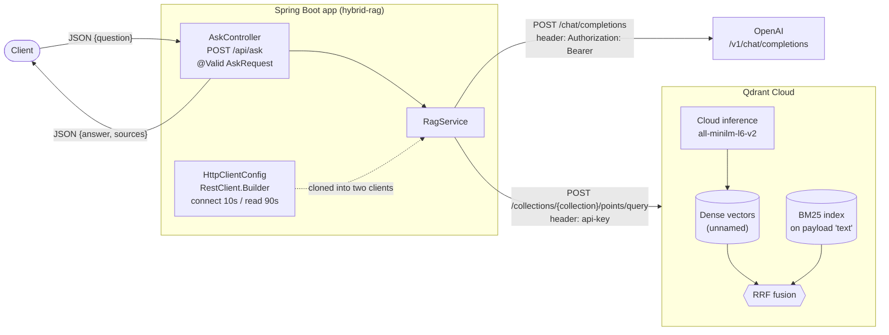
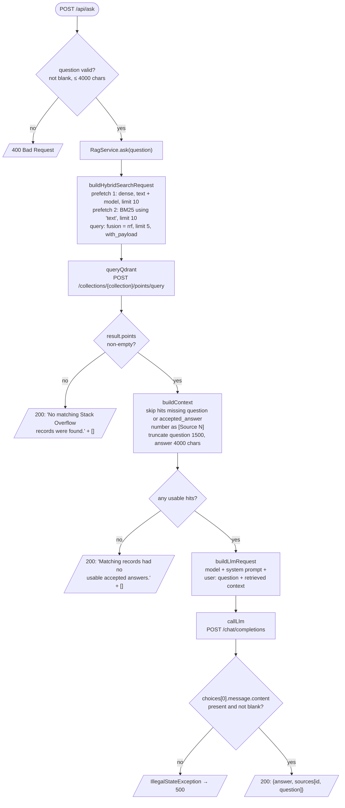
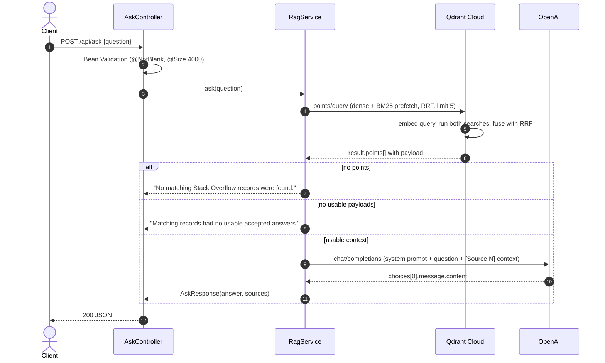

# Architecture

This page shows how a question travels through the service. Diagrams are Mermaid, so they render directly on GitHub.

## Components

## Request flow

## Sequence

Errors from either upstream (timeouts, 4xx, 5xx) are not caught in `RagService`, so they surface as Spring's default 500 response.
